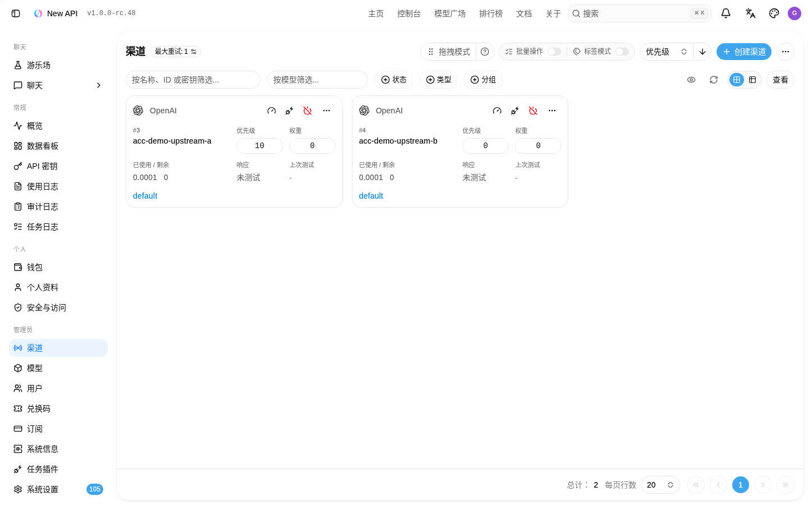
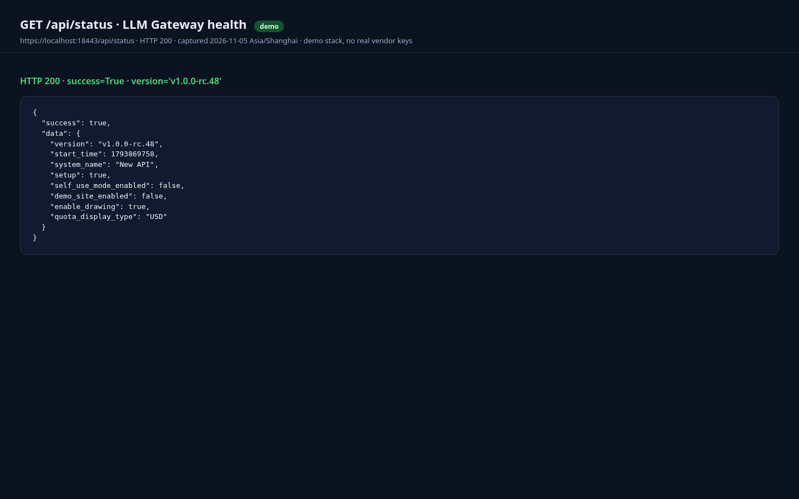
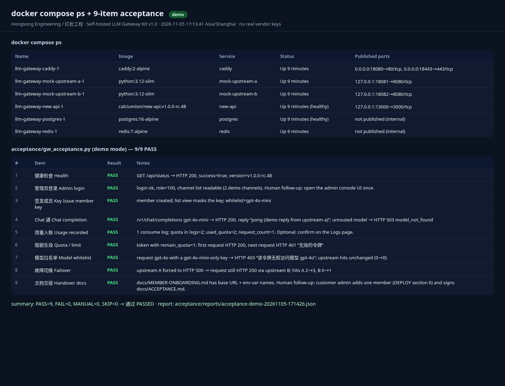

# Self-Hosted LLM Gateway Kit — Bring Your Own Official Keys
*by Hongsong Engineering · 红松工程*

> This repository contains documentation and screenshots only. The paid deploy kit is a paid download: https://hongsongeng.gumroad.com/l/bhgsro

A deployment kit for running an internal, OpenAI-compatible API gateway on your own server using the **official new-api image** (unmodified, pinned): member keys, quotas, model allow-lists, usage logs, failover, HTTPS, backup and upgrade — one command to start the stack, plus a 9-item automated acceptance script. No keys or model access are included.

## Scope of use (read first) · 使用范围（请先读）

**English**
- **For internal use by a team or household only.** It lets your own team / household reach AI models through one gateway; it must not be used to offer a generative-AI service to the public.
- **Official vendor API keys only** — keys from your own accounts with OpenAI, Azure OpenAI, Anthropic, Google, DeepSeek, Kimi, MiniMax, etc. No keys or model access are provided or included.
- **No resale of access**: do not use this kit to resell API access, run shared account pools, or offer a public generative-AI service, and do not use it to bypass vendor terms of service or regional restrictions.
- This kit is **not based on and does not support Sub2API** or any shared-subscription / account-pooling project.

**中文**
- **仅限企业或个人内部使用。** 本套件用于让你自己的团队 / 家庭成员通过统一网关使用 AI 模型，不得用于向公众提供生成式 AI 服务。
- **只接入你自己的官方 API Key**（OpenAI、Azure OpenAI、Anthropic、Google、DeepSeek、Kimi、MiniMax 等厂商官方账户）。不提供、不附带任何 Key 或模型访问权。
- **禁止转售访问权**：不得用本套件转售 API 访问、搭建共享账号池，或向公众提供生成式 AI 服务，也不得用于规避厂商服务条款或地区限制。
- 本套件**不基于、也不支持 Sub2API** 或任何「订阅拼车 / 账号共享」类项目。

## Features
What's in the paid kit (described here; not shipped in this repository):
- **docker-compose** pulling the unmodified official image `calciumion/new-api` (pinned version) plus PostgreSQL, Redis 7.2-alpine, and Caddy with automatic HTTPS
- Scripts for secrets, preflight, backup, restore, and upgrade with rollback
- A **9-item automated acceptance script**
- Deploy manuals in English and 中文
- Security checklist, cost-monitoring docs, and member-onboarding docs
- Personal and commercial licenses

## Bring your own official keys
No API key, credits, or model access is included or sold. Use official vendor API keys from your own accounts (OpenAI, Azure OpenAI, Anthropic, Google, DeepSeek, Kimi, MiniMax, and similar). Your provider bills your usage. This kit is for internal team or household use only.

## Requirements
- Linux server (tested on Debian 13)
- Docker Engine and Docker Compose v2 (tested on Docker Engine 27.3.1, Compose v2.29.7)
- Your own domain and open ports 80/443 for automatic TLS
- Official vendor API keys from accounts you control

## Known limitations
- Tested locally only, on a demo stack with mock upstreams (9/9 acceptance checks passed). Not yet tested end-to-end on a real VPS with a real domain; public ACME/TLS is untested.
- First admin login is a manual step; it is not scripted.
- Tested on Debian 13, Docker Engine 27.3.1, Compose v2.29.7, `calciumion/new-api:v1.0.0-rc.48`, `redis:7.2-alpine`.
- Single-server setup; no high availability or clustering.
- Requires your own domain and open ports 80/443 for automatic TLS.
- The acceptance script checks deployment health, not provider billing or model quality.
- Screenshots were captured on 2026-11-05 (Asia/Shanghai) against an offline demo stack; no real vendor keys were used. Demo channels shown: `acc-demo-upstream-a` / `acc-demo-upstream-b`. No member token keys are shown.

## Upstream
The gateway itself is **new-api** (© QuantumNous and contributors, AGPL-3.0, https://github.com/QuantumNous/new-api). This kit does not include, modify, or redistribute new-api source or its image; `docker compose` pulls the unmodified official image on your server. Keep the UI attribution. The kit is not affiliated with or endorsed by the new-api project.

## Licenses
Personal $29 · Commercial $69. 14-day refund if it does not deploy as documented on a supported setup. No refund for change of mind after download or for disclosed known limitations. You may not resell API access with this kit, and you may not resell or redistribute the kit itself.

## Buy / licenses
- Product: https://hongsongeng.gumroad.com/l/bhgsro
- Personal $29 · Commercial $69
- 14-day refund if it does not deploy as documented on a supported setup
- Details: see [LICENSE-NOTICE.md](LICENSE-NOTICE.md)

## Maintainer
Hongsong Engineering / 红松工程 · hongsong-yu2010-nc52nt@mail.grokbot.com
